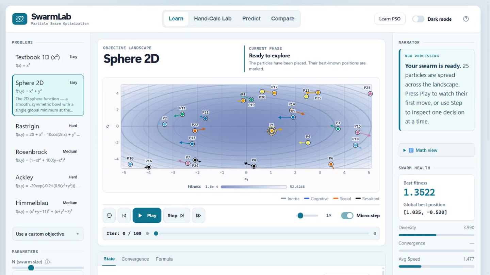
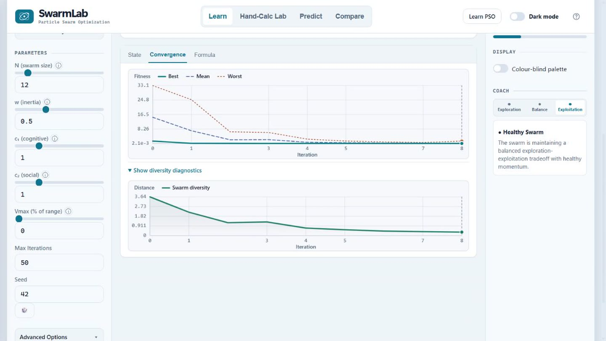
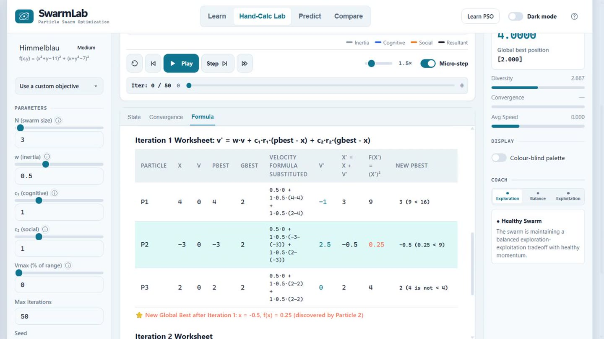
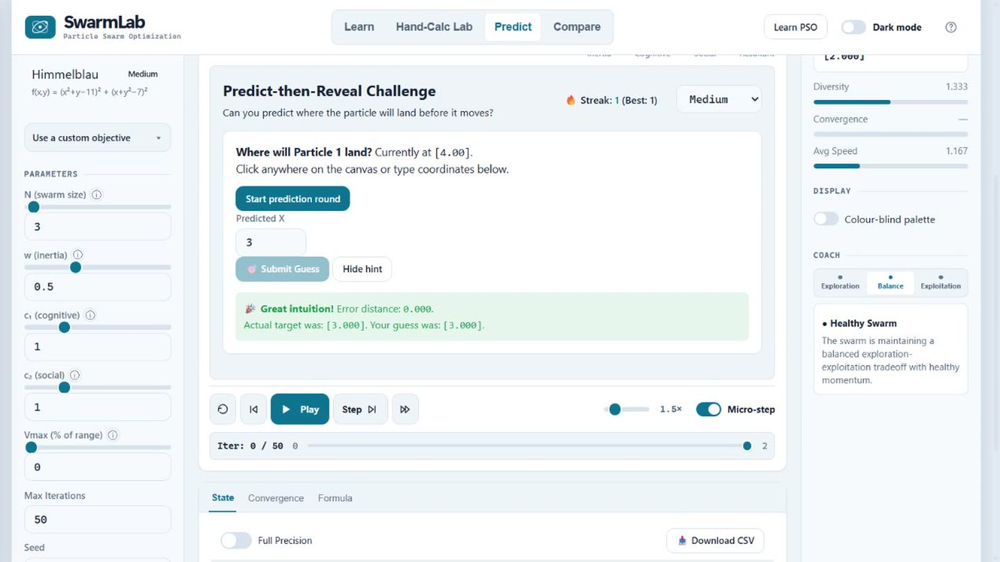
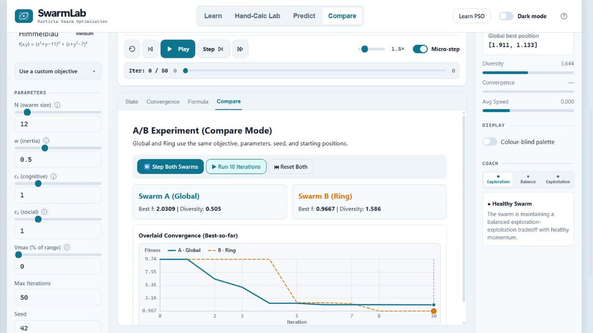
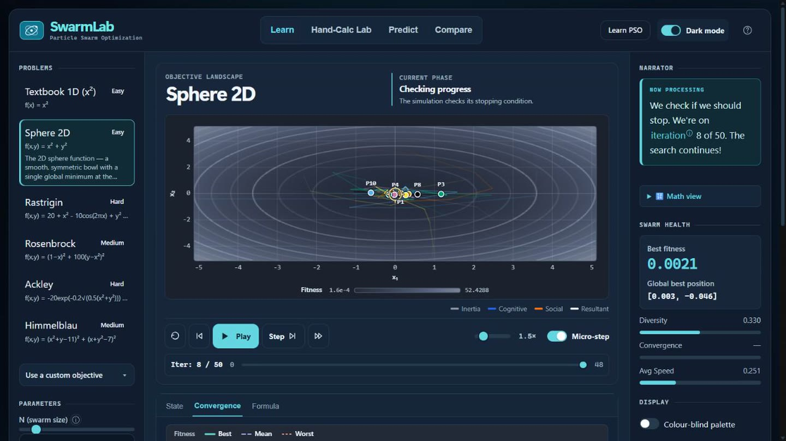

# SwarmLab

SwarmLab is an interactive browser lab for **Particle Swarm Optimization (PSO)**. Choose a minimization problem, configure a swarm, and watch how the particles move, update their personal records, and discover better solutions. The workbench combines the visualization, its underlying data, and a step-by-step explanation in one place.



## Quick start

Run the app from the repository root with a static HTTP server.

```bash
git clone https://github.com/Adi-3108/Interactive-PSO.git
cd Interactive-PSO
python -m http.server 8000
```

Open [localhost:8000](http://localhost:8000). The app uses native JavaScript modules and runs directly in the browser without a build step or backend. Node.js is optional for running the verification scripts.

1. Select **Sphere 2D** and leave **Micro-step** enabled.
2. Click **Step** to inspect the velocity calculation. Open **Math view** beside the Narrator to see its terms.
3. Click **Play** to run automatically. Use **Pause** to inspect the plot and the **State** table together.
4. Open **Hand-Calc Lab → Load Textbook Example** to reproduce a known answer by hand.

## Problems and custom objectives

Each particle represents a candidate value of `x` or a candidate pair `(x, y)`. The objective gives that candidate its **fitness**. In this app, lower fitness is better.

| Problem | Difficulty | What it demonstrates |
| --- | --- | --- |
| **Textbook 1D (x²)** | Easy | A one-dimensional parabola with its minimum at zero. Use it to follow arithmetic by hand. |
| **Sphere 2D** | Easy | A smooth bowl, `x² + y²`, with a minimum at the origin. Use it to see how particles gather around a good position. |
| **Rastrigin** | Hard | Many regularly spaced local minima. Use it to explore how a swarm can settle in one valley before finding a better one. |
| **Rosenbrock** | Medium | A narrow, curved valley leading to the minimum at `(1, 1)`. Use it to study how particles follow a difficult path. |
| **Ackley** | Hard | A broad, nearly flat outer region with small local minima and a deep central basin. Use it to compare exploration and refinement. |
| **Himmelblau** | Medium | Four equally good global minima. Use it to see whether a swarm splits across different basins. |

Expand **Use a custom objective** to enter an expression such as `x^2 + 2*y^2` or `sin(x) + x^2 / 10`. Use `x` and `y`, parentheses, `+ - * / ^`, constants `pi` and `e`, or functions `sin`, `cos`, `tan`, `exp`, `log`, `sqrt`, and `abs`. Use explicit multiplication, such as `2*x`. The interface reports parsing errors next to the field. For a custom objective, choose an expression that stays finite throughout the plotted domain.

## Learn mode

### Visualization and playback

- The **1D objective curve** shows fitness as a function of position. The **2D heatmap** uses contour lines and a fitness scale to show the shape of the search space.
- Particle markers, trails, velocity arrows, personal bests, and the swarm leader show how the search changes. Hover over a particle to inspect it. The force legend distinguishes inertia, cognitive pull, social pull, and the resultant velocity.
- **Play** and **Pause** control automatic playback. The speed slider ranges from **0.25× to 10×**.
- **Step** advances one phase when **Micro-step** is enabled. The order is **compute velocity → move → evaluate fitness → update personal bests → update the swarm leader → check the stopping condition**.
- **Next iteration** advances through the remaining phases of the current iteration. With **Micro-step** disabled, **Step** advances at iteration level.
- **Step Back** and the **timeline scrubber** revisit recorded states. **Reset** starts the selected experiment again from its starting conditions.

### Narrator, Math view, and Swarm Health

The stage header names the current phase. The **Narrator** explains why it happens in plain language and links to definitions of algorithm terms. Expand **Math view** or open **Formula** below the plot to inspect the mathematical details for the current phase.

The **Swarm Health** panel shows the best fitness found so far, its position, diversity, convergence, and average speed. The **Coach** tracks the balance between exploration and exploitation. Its diagnostics flag patterns such as excessive motion, stagnation, and premature convergence. When a recommendation is available, **Apply Suggestion** updates the settings and starts a fresh run so you can compare the result.

### State, charts, and CSV

- **State** lists positions, velocities, current fitness, and each particle's best position and score. The leader row highlights the best result found by the swarm.
- **Full Precision** shows more digits for inspecting calculations. **Download CSV** exports retained particle history for spreadsheet analysis.
- **Convergence** plots best, mean, and worst fitness by iteration. Open **Show diversity diagnostics** to plot swarm spread. Select a point along either chart's time axis to revisit the corresponding iteration.



## Configure an experiment

| Setting | Effect |
| --- | --- |
| **Swarm size (N)** | Sets the number of candidates. The interface supports 1–100 particles. |
| **Inertia (w)** | Scales how much previous velocity carries forward. Higher inertia can keep particles moving and spread out for longer. |
| **Cognitive weight (c₁)** | Changes the pull toward each particle's own best position. |
| **Social weight (c₂)** | Changes the pull toward the best position found by the particle's group. The selected topology defines the group. |
| **Vmax** | Caps the magnitude of each velocity component as a percentage of its domain span. Set it to 0 to turn the cap off. |
| **Max iterations** | Sets the iteration limit used by playback. |
| **Seed** | Reproduces an experiment's random start and random choices when the setup is held fixed. Use the dice button to generate a new seed. |

The core update combines momentum, personal memory, and social information:

```text
new velocity = w × velocity
             + c₁ × r₁ × (personal best − position)
             + c₂ × r₂ × (group best − position)
new position = position + new velocity
```

Changing a parameter during playback pauses the run. The notification offers **Reset from Start** and, for settings that support it, **Continue Run** to apply the change to the existing swarm.

### Advanced options and presets

| Option | Choices and behavior |
| --- | --- |
| **Boundary** | **Clamp** holds an out-of-range coordinate at the edge. **Reflect** bounces it back. **Absorb** brings it to the edge and zeroes the affected velocity component. **None** leaves the motion unrestricted. |
| **Topology** | **Global (gbest)** uses the best position found anywhere in the swarm. **Ring (lbest)** uses local neighborhood information. |
| **Update mode** | **Synchronous** calculates the iteration's movement from a common starting state. **Asynchronous** lets later particles use improvements found by earlier particles in that iteration. |
| **Inertia schedule** | Use a constant weight or lower it linearly from `w` toward `w/2` over the run. |
| **Constriction (χ)** | Enables the Clerc–Kennedy constriction factor for the velocity update. |

The presets give you a starting point for a controlled experiment.

- **Textbook 1D Example** loads the three-particle worked example.
- **Balanced Default** loads a balanced Sphere 2D setup.
- **Greedy Swarm (High c₂)** emphasizes the swarm leader.
- **Lonely Explorers (High c₁)** emphasizes personal records.
- **Momentum Overload** increases inertia to demonstrate unstable motion and the Coach warning.
- **Ring Topology on Rastrigin** combines local neighbors with a landscape containing many valleys.

### Try a 20-iteration inertia experiment

On Sphere 2D, set **N = 12**, **seed = 42**, and **max iterations = 20**. Keep the other settings fixed. Run with `w = 0.35`, then reset with `w = 0.90` and run again. Compare the diversity and average speed at iteration 5 using the timeline. In the recorded demo, diversity was about **0.350** with lower inertia and **1.665** with higher inertia. This comparison uses the same starting conditions so the change in motion is easier to attribute to inertia.

## Hand-Calc Lab

Choose **Load Textbook Example** to set up three particles at `4`, `−3`, and `2`, initially at rest, on `f(x) = x²`. The worksheet shows the first two iterations, including the substitutions, new velocities and positions, objective values, and personal and global records.

In the first iteration, particle 2 starts at `−3` and is guided by the initial leader at `2`. With the reference factors set to 0.5, its velocity is `0.5 × (2 − (−3)) = 2.5`. Its new position is `−0.5`, which gives fitness `0.25`. This becomes the swarm's best record.

Enter alternative **Manual r₁** and **Manual r₂** values to experiment. **Run Engine Auto-Check** compares the computed results against the fixed reference. To reproduce the reference, select **Set r₁=r₂=0.5** and run the check again.



## Predict-then-Reveal

Click **Start prediction round** to see a particle's starting position before its next move. Enter a predicted **X** in 1D, enter **X** and **Y** in 2D, or choose a point on the plot. Submitting the guess reveals the actual landing point and its distance from the guess. The interface tracks the current and best streak.

- **Easy** starts with force hints enabled.
- **Medium** lets you show or hide the hints.
- **Hard** disables hints.

For a quick reference round, load the Textbook 1D Example, switch to **Predict**, and guess `3` for particle 1. The reference run reports a distance error of zero.



## Compare mode

**Compare** runs **Swarm A (Global)** and **Swarm B (Ring)** with the same objective, parameters, seed, and starting positions. The difference is how each swarm shares its best discoveries.

Use **Step Both Swarms** for one iteration, **Run 10 Iterations** for a batch, and **Reset Both** to return to the shared start. Compare best fitness, diversity, and the overlaid best-so-far curves. Rastrigin and Himmelblau are useful examples because there are multiple valleys or basins to explore.



## Help, display, and keyboard controls

- **Learn PSO** opens a short lesson on the intuition and update rule, followed by a concept quiz.
- **Help** lists the keyboard controls and opens the guided tour.
- **Dark mode** changes the workbench and graph colors. **Colour-blind palette** switches the heatmap to grayscale and changes the force colors. Both choices are remembered in the browser.
- On narrow screens, open **Experiment settings** and **Narrator** from the drawer buttons to keep the plot accessible.

| Key | Action |
| --- | --- |
| Space | Play or pause |
| Right arrow | Step forward |
| Left arrow | Step back |
| Shift + Right arrow | Advance to the next iteration |
| R | Reset |
| M | Toggle Micro-step |
| D | Toggle dark mode |
| ? | Open Help |
| Esc | Close a dialog or drawer |



## Verify the engine

Select the **Engine Verified Against Textbook** badge in the app to see individual results and re-run the checks. With the local server running, you can also open [the standalone verification page](http://localhost:8000/js/tests/tests.html). Its 40 checks cover the worked example and engine behavior.

Run the deterministic textbook test from the repository root with Node.js:

```bash
node js/engine/test_pso.js
```

The test prints the initial particle state and both iterations. It checks that the best result is `x = −0.5` and `f(x) = 0.25`.

## Project layout and deployment

| Path | Purpose |
| --- | --- |
| `index.html` | Workbench markup, controls, and guided tour |
| `css/` | Themes, responsive layout, and component styles |
| `js/engine/` | PSO, benchmarks, seeded random numbers, and recorded history |
| `js/ui/` | Canvas visualization, charts, playback, learning modes, and diagnostics |
| `js/tests/` | Standalone browser verification and test cases |
| `docs/screenshots/` | Screenshots from the running workbench |

Publish the repository root on a static host and deploy the `master` branch. For a Render Static Site, leave **Root Directory** blank, use `true` as the **Build Command**, and set **Publish Directory** to `.`. For GitHub Pages, publish the `master` branch from `/ (root)`.

## Team members

- **Aditya Kumar Upadhyay** (LIT2024014)
- **Naman Gulati** (LIT2024037)
